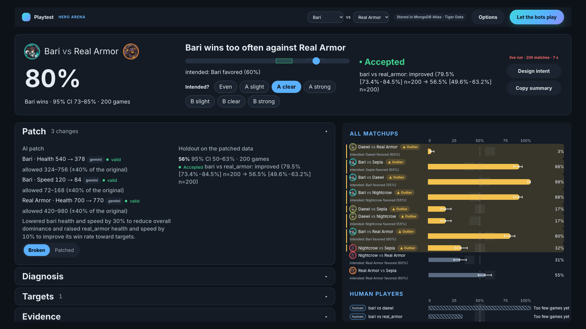
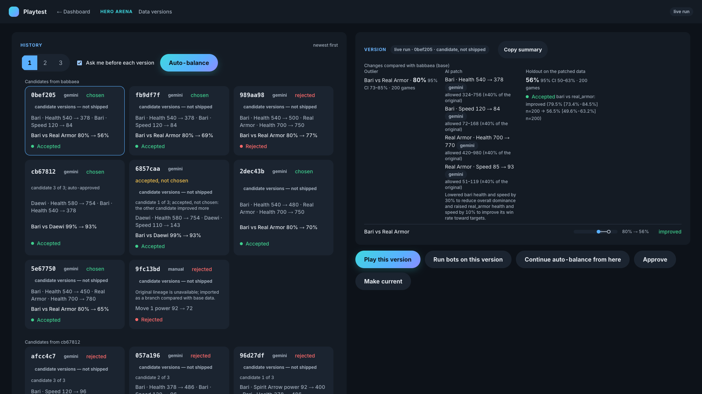
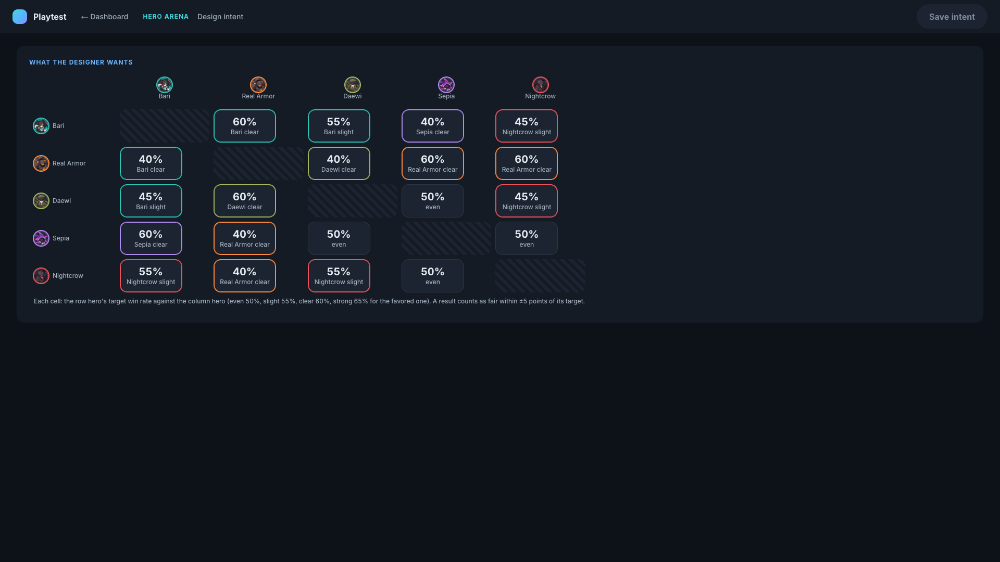
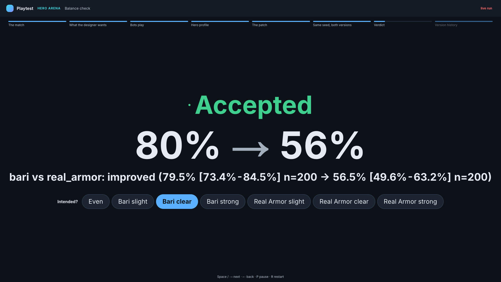
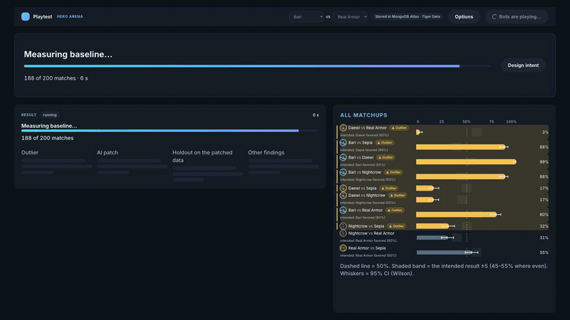
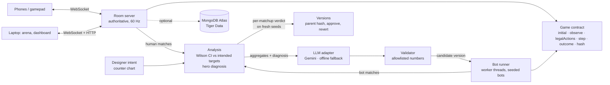

# balance-forge

**Let the bots play. Ship balance you can prove.**

AI playtesting for game developers.
- Bots play hundreds of seeded matches.
- The platform compares every matchup with the **designer's intended counter chart** and diagnoses which hero is too strong or too weak.
- An LLM (Gemini) proposes a numeric patch, and the patch is re-tested on fresh seeds before it counts.
- Accepted patches become **versions, like git commits**.
- Problems that numbers cannot fix are handed to a designer with replay evidence.
- Players join from their phones by QR code, and every human match is recorded next to the bot data.

Built solo during **HackPrinceton Fall 2026** (Nov 13–15). The author made the design and integration decisions; AI coding assistants helped write and review code.

## Try it
```
npm install
npm run demo
```
`npm run demo` builds the web app if needed and starts one server on port 3000 for the web app, the HTTP API and the WebSocket. It prints a laptop URL and a QR code for phones. Open the printed URL on the laptop, not `localhost`, so the lobby QR points phones to the right address. If the live server cannot start, the command serves a recorded run instead.

Optional secrets are read from the environment or, on macOS, from Keychain items of the same name. Values are passed to the server only and never printed.

| Secret | Effect |
|---|---|
| `GEMINI_API_KEY` | live Gemini patch proposals (`GEMINI_MODEL` defaults to `gemini-flash-lite-latest`) |
| `XAI_API_KEY` | the Grok adapter |
| `MONGODB_URI` | stores versions, reports and human matches in MongoDB Atlas |
| `TIGER_DATABASE_URL` | stores one row per match in Tiger Data, which feeds "win rate across versions" |

For phones on another network, run `cloudflared tunnel --url http://localhost:3000`, then start the demo again with `PUBLIC_URL=<https url> npm run demo`.

Screens: `#/lobby` · `#/dashboard` · `#/intent` (counter chart) · `#/versions` · `#/skill` (trained bots) · `#/present` (2-minute presenter mode).

## Screens

Taken from the live server (a 200-match run of Bari vs Real Armor, Gemini patch).











## How it works


1. **One contract, any genre.** A game implements a small set of pure functions. The server, the bots, the phone controller and the analysis only talk to that contract. A real-time duel (Hero Arena) and a turn-based card duel (Hero Cards) both run on it.
2. **Deterministic simulation.** Integer math, a seeded PRNG, fixed 60 Hz ticks and canonical state hashes. The same seed and inputs give the same match on any machine, so a before/after comparison changes only the patch, and any match can be replayed exactly.
3. **Bots with seeded personalities.** Each bot seat draws its reaction delay, guard chance, distance and aim from its own seeded generator, so every seed plays a different match, and any match can still be replayed. Every result is tagged with the bot policy that produced it.
4. **Judged against intent, not 50/50.** The designer sets a counter chart: even, slight, clear or strong (50/55/60/65% for the favored side). A matchup is flagged only when its whole Wilson 95% interval sits outside its target ±5 points, with at least 30 games, and a hero's overall rate must stay within 45–55%. The intent can be changed with a tap on the result screen, and the stored run is re-judged instantly.
5. **Diagnosis, not just a number.** Both heroes of a flagged matchup are measured against every opponent. The result is classified as overall strong, overall weak, or counter-specific, with ranked fixes: the hero's own moves first, then its health or speed, and shared moves last, labelled with the other heroes they change.
6. **Safe AI patches.** The LLM sees aggregates and the diagnosis only, and must return a `PatchProposal`: up to 8 integer changes on allowlisted fields (move power, damage scale, each hero's health and speed within ±40% of the original). The validator checks it. The patch is accepted only if a target matchup moves toward its intended rate on **fresh seeds**, none gets worse beyond noise, and no new extreme appears. If the LLM fails, a labelled offline sample is used and the reason is shown.
7. **Versions and auto-balance.** Every candidate is a version with a parent hash. You can play it on phones, run bots on it, continue from it or make it current; nothing is deleted. Auto-balance tries up to three sibling candidates per round on the same fresh seeds and keeps the best accepted one. "Ask me before each version" is on by default.
8. **Humans in the loop.** Phones send the same input format as bots. The server holds each player's last move every tick and records it, so play feels smooth and replays stay exact.

## Measured numbers
All on one laptop. Win rates are for the first-named hero, with 200 games per matchup unless noted.

| What | Result |
|---|---|
| Determinism | 100 seeds × 1,000 ticks, run twice, 5 heroes: every state hash identical |
| Intended flaw (bot policy 0.2.1) | Bari vs Real Armor **79.5%** (95% CI 73.4–84.5); the designer intended 60% |
| Live loop with Gemini | Gemini proposed Bari health 540 → 450 and Real Armor 700 → 780. Re-test on fresh seeds: **79.5% → 65.0%**, accepted. Baseline 200 matches in about 5.5 s; the whole measure → patch → re-measure loop took about 21 s |
| Auto-balance, 3 rounds (offline proposer) | Daewi health 580 → 754 (vs Real Armor 2.5 → 12.5%); Bari health −30% (vs Real Armor 82.5 → 61.5%); Bari arrow 92 → 74 (vs Daewi 91.5 → 81.5%). Daewi's attack and speed +30% changed nothing and were rejected |
| Play style matters | Bari vs Real Armor across three bot policies: 54.0% / 79.5% / 90.0% |
| Self-play trained bots (CEM, Nightcrow held out) | Daewi vs held-out Nightcrow 11% → 80%. Sepia generalized worse than its start (86% → 72%). Trained vs trained makes the imbalance worse (Bari vs Real Armor 97%) |
| Search vs blind mutation (Daewi, same budget) | faster fitness curve with CEM, same held-out level (78% vs 82%, intervals overlap); indicative only |
| Tests | about 400 pass, 0 fail, including real WebSocket tests and end-to-end flows |

## What is real and what is not
- **Real:** the simulation, bots, statistics, intent-based judging, diagnosis, the Gemini call, validation, versions, phone play and recorded human matches.
- **Recorded:** a run marked `recorded` was played earlier by this code and stored. The dashboard plays it back when the live server is unavailable.
- **Offline sample:** without a Gemini key, a rule-based proposer is used and labelled with the reason.
- **Intentional:** the sample games ship with deliberate flaws for the platform to find.
- **Not done yet:** human-style bots learned from recorded matches; a third sample game.

## Layout
- `spec/`: shared game contract v0.1 and addenda v0.1.1–v0.1.3 (assignments, hero-stat patches, designer intent)
- `fixtures/`: example data every package tests against
- `packages/contracts`, `packages/sim`, `packages/games`: contract types, deterministic core, sample games, bot policies
- `services/runner`: the bot runner, recorded runs and trained bot parameters (`learned/`)
- `services/room`: the authoritative room server and HTTP API, plus the designer intent file (`design/`)
- `services/sinks`: optional MongoDB Atlas and Tiger Data stores
- `packages/analysis`: reports, Wilson intervals, intent targets, diagnosis, patch validation, LLM adapters, verdicts, auto-balance
- `apps/web`: lobby, arena, phone controller, cards, dashboard, versions, intent, presenter (React, Phaser, Vite)
- `docs/ui-tone.md`: visual tone and design tokens

## Rights
The characters and art are original and **all rights reserved**; see [ASSETS_LICENSE.md](ASSETS_LICENSE.md). They are here to demo the platform, not for reuse.
