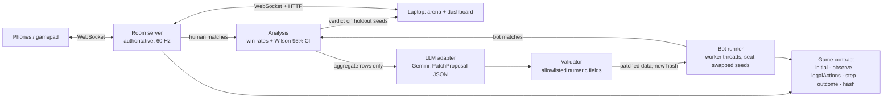

# balance-forge

**Let the bots play. Ship balance you can prove.**

AI playtesting for game developers. Bots play thousands of matches, the platform finds the balance problem, an LLM proposes a numeric patch, and the same seeds re-run to prove the fix. Players join from their phones by QR code, and every human match lands in the same report next to the bot data.

Built solo during **HackPrinceton Fall 2026** (Nov 13–15). The author made the design and integration decisions; AI coding assistants helped write and review code.

## Try it
```
npm install
npm run demo
```
`npm run demo` builds the web app if needed. It starts one server on port 3000 that serves the web app, the HTTP API and the WebSocket. It then prints a laptop URL and a QR code for phones. Open the printed URL on the laptop, not `localhost`, so the lobby QR points phones to the right address. If the live server cannot start, the command serves a recorded run instead.

For phones on another network, run `cloudflared tunnel --url http://localhost:3000`, then start the demo again with `PUBLIC_URL=<https url> npm run demo`.

## How it works


1. **One contract, any genre.** A game implements a small set of pure functions. The server, the bots, the phone controller and the analysis all talk only to that contract. A real-time duel and a turn-based card game run through the same pipeline.
2. **Deterministic simulation.** The simulation uses integer math, a seeded PRNG, fixed 60 Hz ticks and canonical state hashes. The same seed and inputs give the same match on any machine. That makes a before/after comparison change only the patch, and lets any match be replayed exactly.
3. **Honest statistics.** Every pair of matches swaps seats. A matchup is flagged only when its whole Wilson 95% interval sits outside 45–55%, with at least 30 games. Invalid matches are counted separately, never as draws.
4. **Safe AI patches.** The LLM sees aggregate rows only. It must return a `PatchProposal`: up to 8 numeric changes on allowlisted fields, tied to the base data hash. The server validates the proposal and re-runs the match on **holdout** seeds. It accepts the patch only if the matchup moves toward 50% and no other matchup goes over 65%. If the LLM call fails, a validated fallback patch is used and labelled `fallback`.
5. **Humans in the loop.** Phones send the same input format as bots. Every human match is recorded in the same format as bot matches, so the report shows what players felt beside what the bots measured.

## Measured numbers
All on one laptop. Throughput includes worker startup.

| What | Result | When |
|---|---|---|
| Determinism: 100 seeds × 1,000 ticks, run twice, 5 heroes | every input and state hash identical (48.8 s) | 2026-11-14 |
| Bot throughput: 15 matchups × 10 seeds × 2 seat orders | 300 / 300 valid matches in 6.27 s (47.8 matches/s, 2 workers) | 2026-11-14 |
| Tests | engine 77, analysis 109, web 46 pass; 16 real-socket room tests pass | 2026-11-14 |
| Imbalance found → patch → holdout | _filled in from the demo run_ | — |

## What is real and what is not
- **Real:** the simulation, bot runs, statistics, patch validation, replays and the phone controller over WebSocket.
- **Recorded:** a run marked `recorded` was played earlier by this code and stored. The dashboard plays it back when the live server is unavailable.
- **Intentional:** each sample game ships with one deliberate flaw for the platform to find, marked in its data.
- **LLM:** the Gemini adapter reads `GEMINI_API_KEY` from the environment (optional `GEMINI_MODEL`). Without a key, the fallback patch is used and labelled as such.

## Layout
- `spec/`: shared game contract v0.1 and the v0.1.1 addendum
- `fixtures/`: example data every package tests against
- `packages/contracts`, `packages/sim`, `packages/games`: contract types, deterministic core, sample games
- `services/runner`, `services/room`: bot runner and the authoritative room server
- `packages/analysis`: reports, Wilson intervals, patch validation, LLM adapters, verdicts
- `apps/web`: laptop arena, phone controller, lobby and dashboard (React, Phaser, Vite)
- `docs/ui-tone.md`: visual tone and design tokens

## Rights
The characters and art are original and **all rights reserved**; see [ASSETS_LICENSE.md](ASSETS_LICENSE.md). They are here to demo the platform, not for reuse.
